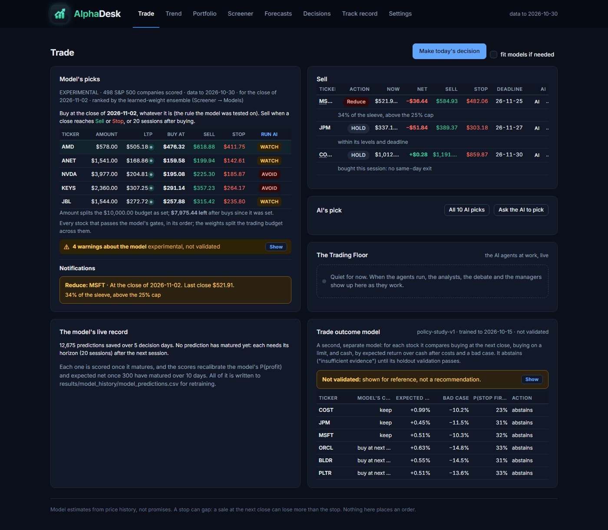
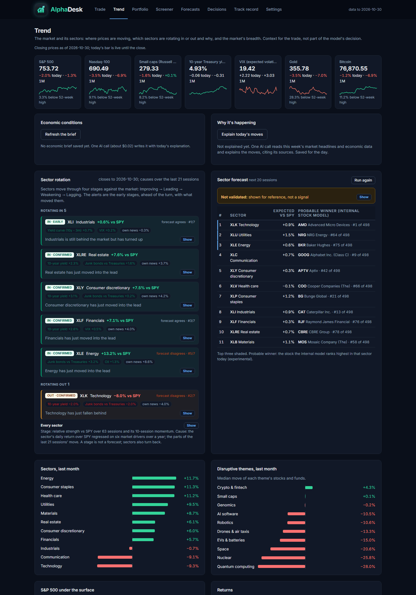
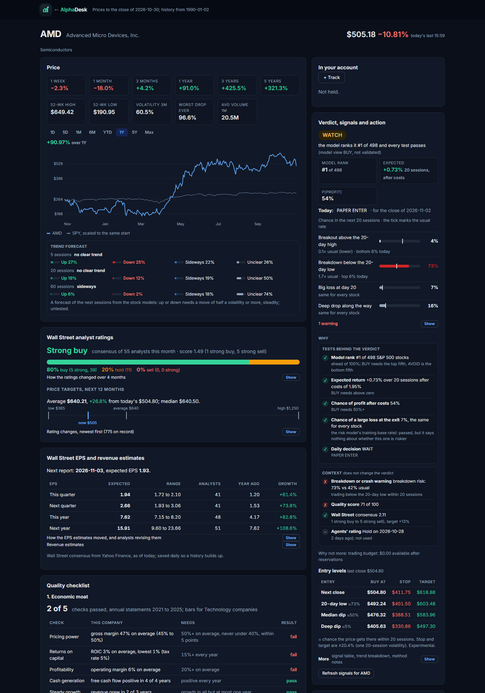
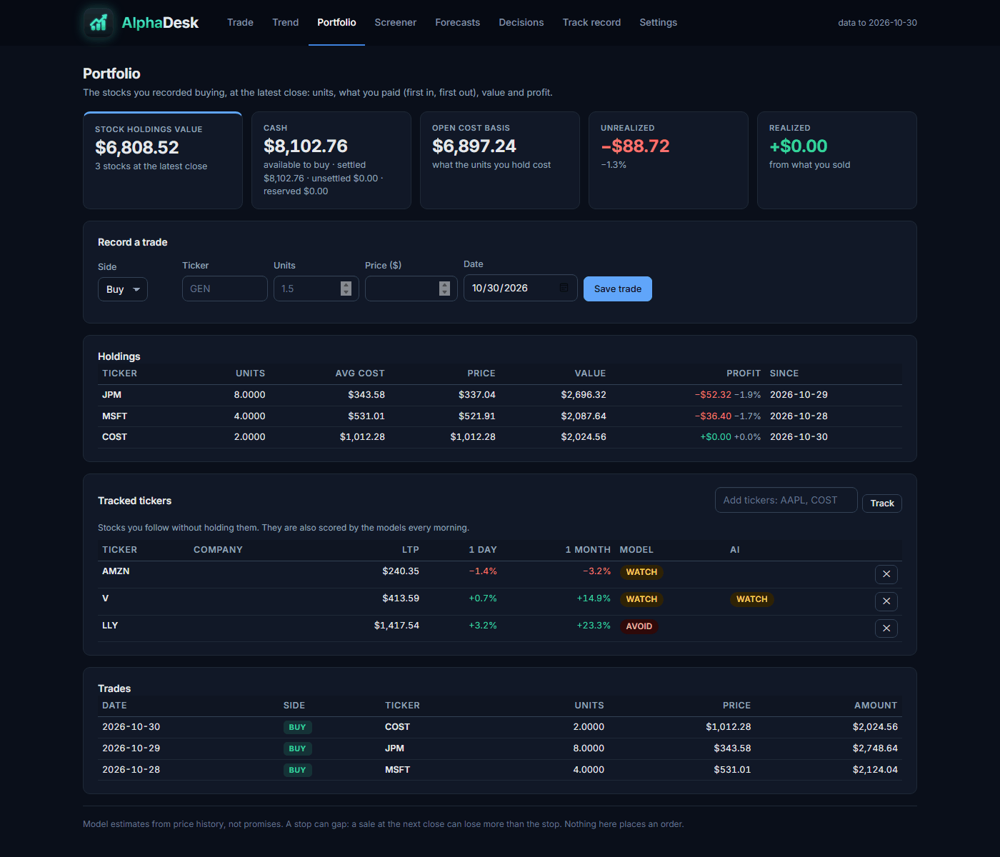
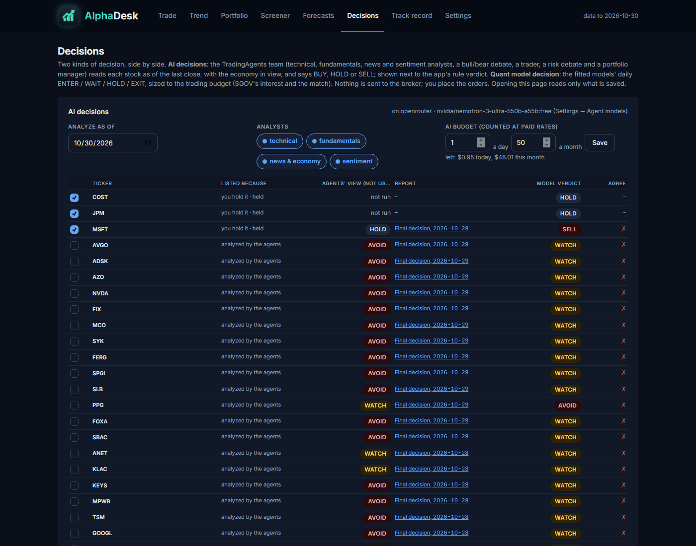
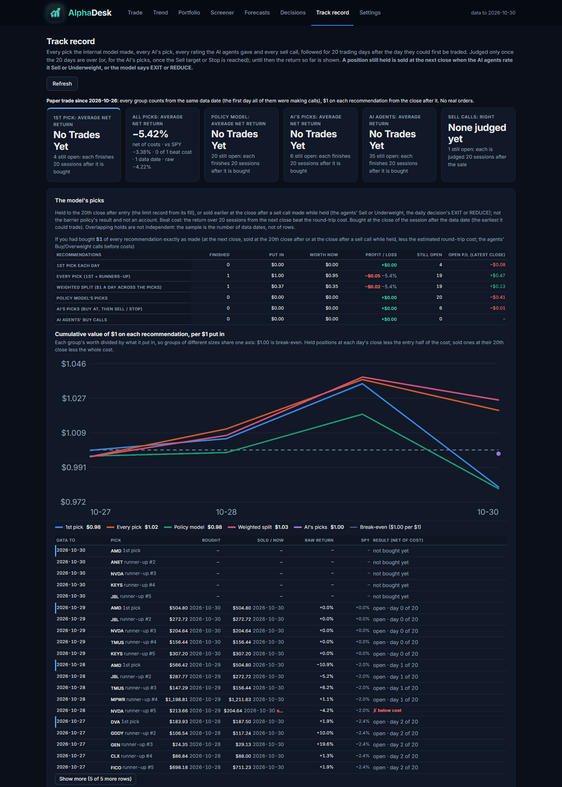
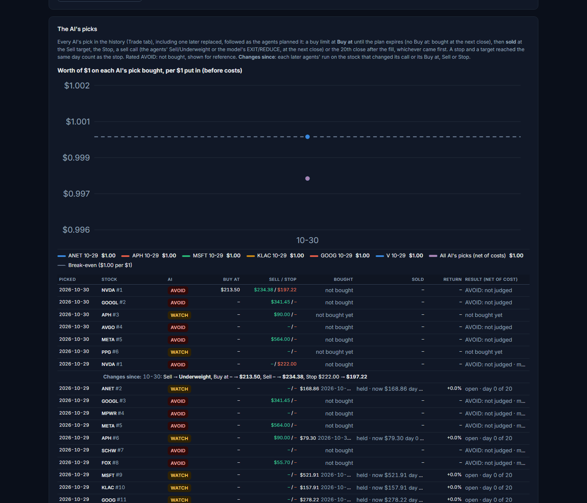
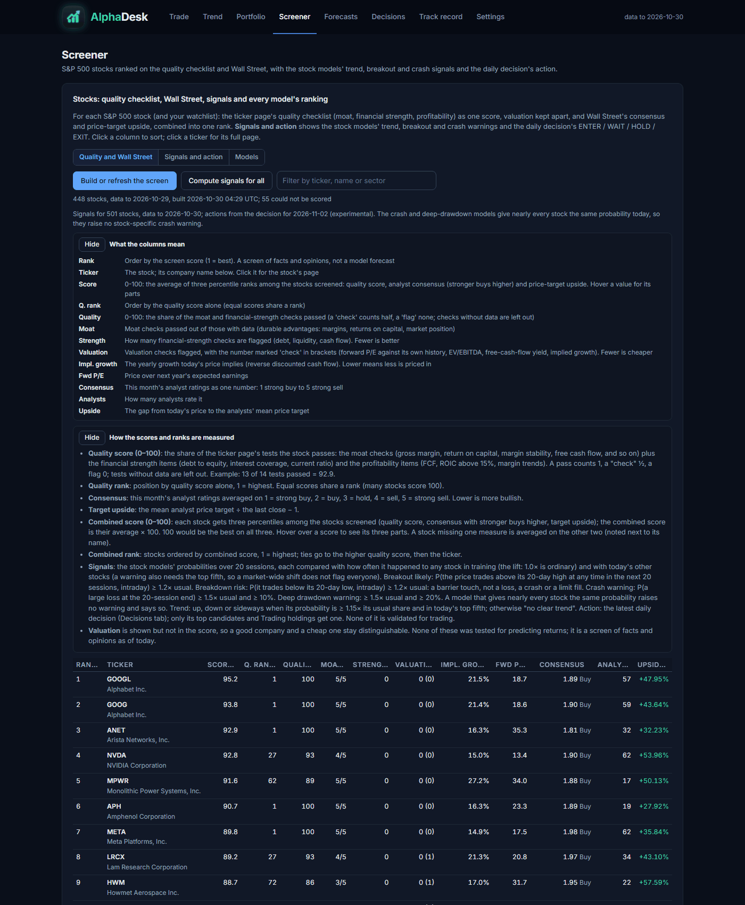
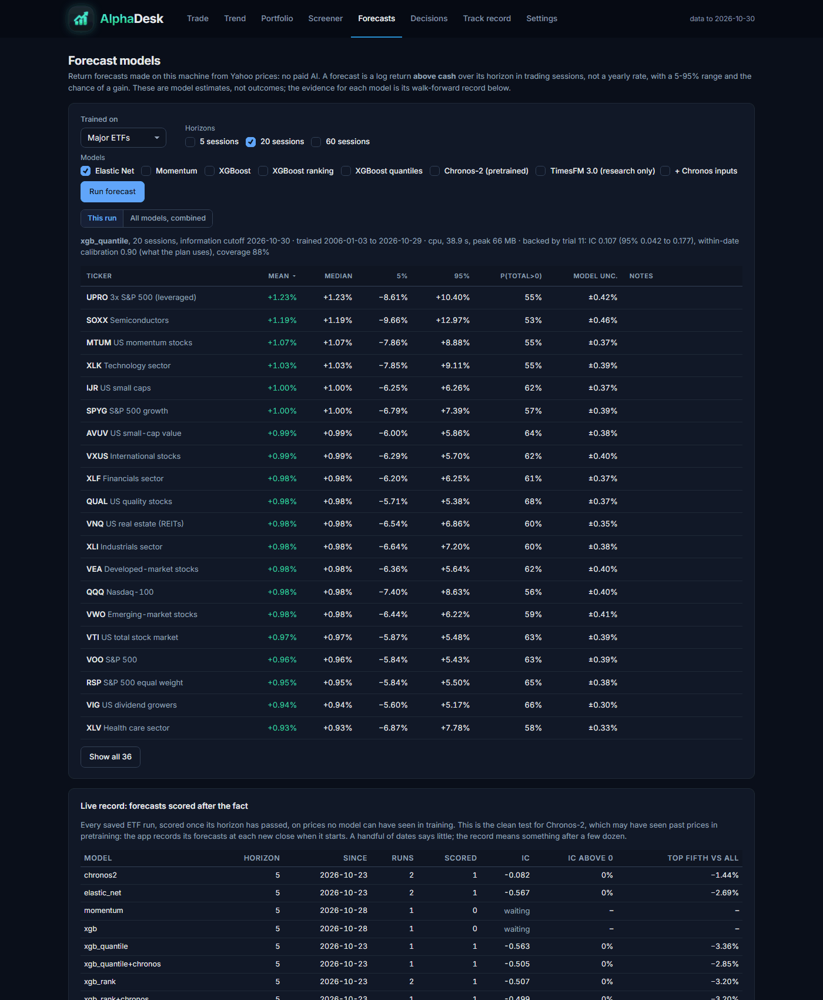
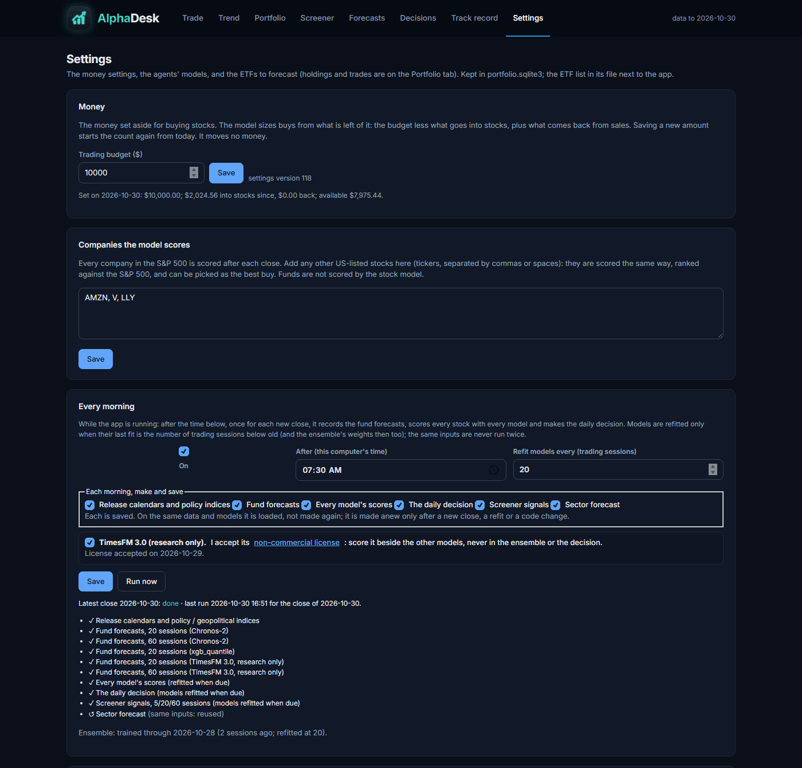

<p align="center">
  
</p>

# AlphaDesk: App User Guide

AlphaDesk is a stock-trading desk that runs on your own computer. Every trading day it scores the
S&P 500 (and any stocks you add) with its own models, suggests what to buy and sell within a budget you set,
and can ask a team of AI agents (analysts, a bull/bear debate, a trader, risk analysts and a portfolio
manager) for a second opinion on any stock. It keeps an honest track record of every pick it made.

> **AlphaDesk never places an order.** You place trades yourself in your broker's app, then record them in
> AlphaDesk. Everything it shows is a model estimate from past data, not a promise and not financial advice.

---

## 1. Install

You need **Python 3.11 or newer** ([python.org](https://www.python.org/downloads/)).

**From the installer file** (`tradingagents-<version>-py3-none-any.whl`):

```bash
pip install tradingagents-0.7.0-py3-none-any.whl
# with the forecasting models (XGBoost, LightGBM, DuckDB, GARCH, Mamba):
pip install "tradingagents-0.7.0-py3-none-any.whl[research]"
```

**From this repository:**

```bash
git clone <this repository's URL>
cd <the cloned folder>
pip install -e ".[research]"
```

To build the installer file yourself: `uv build --wheel --out-dir dist` (or `python -m build --wheel`).

## 2. Start and stop

Make a folder for your records, open a terminal in it, and run:

```bash
tradingagents web
```

AlphaDesk opens in your browser at **http://127.0.0.1:8765/**. Press **Ctrl+C** in the terminal to stop it.

- `--port 8800` runs it on another port. Only one copy can use a port at a time.
- Run it from the same folder each time: that folder holds your records (see section 5).
- If the `tradingagents` command is not found, use `python -m cli.main web` instead.

## 3. First-time setup (Settings tab)

1. **API keys.** Paste the keys you have. They are saved in a `.env` file in your records folder, used at
   once without a restart, and only ever shown masked. None is required to browse prices and models; the AI
   features need at least one model provider.

   | Key | Used for |
   |---|---|
   | `OPENAI_API_KEY`, `ANTHROPIC_API_KEY`, `GOOGLE_API_KEY`, `OPENROUTER_API_KEY`, `XAI_API_KEY`, `DEEPSEEK_API_KEY`, … | The AI agents (any one provider is enough) |
   | `OPENROUTER_API_KEY_2` | A second OpenRouter key, tried when the first hits a limit |
   | `GEMINI_CONTEXT_API_KEY` | Non-agent AI work: the Trend page brief, ticker news, the moat check |
   | `FRED_API_KEY` | Economic data (free at [fred.stlouisfed.org](https://fred.stlouisfed.org/docs/api/api_key.html)) |
   | `ALPHA_VANTAGE_API_KEY` | Optional backup market data |

2. **Agent models.** Choose a default provider, a *quick* model (analysts, debaters, trader) and a *deep*
   model (research and portfolio managers). Putting the two sides of each debate on different providers stops
   one model arguing with itself. **Every model needs a price** (dollars per million tokens); a model with no
   price is refused before any call, so its cost can be held to your budget. *Use free Gemini* sets up a
   no-cost configuration.
3. **Money.** Set the **trading budget**: the money set aside for buying stocks. Buys are sized from what is
   left of it. Saving a new amount starts the count again from today. It moves no money.
4. **Companies the model scores.** The whole S&P 500 is scored after each close; add any other US-listed
   stocks here.
5. **Every morning.** With the app running, after the time you choose it records the fund forecasts, scores
   every stock with every model and makes the daily decision, once per new close. Models are refitted every
   *N* trading sessions (you choose *N*).

## 4. How to use it, step by step

The screenshots below come from a demo copy of the app: real market data with made-up holdings and a $10,000
budget. Click any picture to see it full size.

### Step 1: Make today's decision (Trade tab)

Open AlphaDesk after the market closes or before the next open; the models work from the last completed close.
Press **Make today's decision** (tick *fit models if needed* the first time).



- **Model's picks** (left): the best buy and the runners-up. **Amount** splits your trading budget across them
  (the line under the table says how much of the budget is left). **LTP** is the last price, live from Yahoo
  with a green dot while the market is open. **Buy at** is the limit price to use; **Sell** and **Stop** are
  where to take the profit or cut the loss. The **AI** column runs the AI agents on that stock.
- **Sell** (right): every stock you hold, with the suggested action (HOLD, REDUCE or EXIT), the profit so far,
  its sell target, stop and deadline, and why. Here MSFT is too large a share of the account, so it says REDUCE.
- **AI's pick**: *Ask the AI to pick* has an AI rank the market and the full agent team analyse its top
  stocks; *Replace the AVOIDs* screens again for the ones the team rejected. **The Trading Floor** shows the
  agents at work, live.
- **Notifications** repeat anything you need to act on, such as a sale.

### Step 2: Check the market (Trend tab)

Context for the day, not part of the decision: the indices, economic conditions, *Why it's happening* (one AI
call explains the moves, citing its sources), which sectors are rotating in or out and why, and the sector
forecast.



### Step 3: Look closer at a stock (click any ticker)

Every ticker opens its own page: the price chart against SPY, the trend forecast, Wall Street's ratings and
price targets, earnings estimates, the quality checklist, and on the right the model's **verdict**, its tests,
its signals and the **entry levels** (Buy at, Stop and Target for buying at the next close or on a dip).
The agents' plans and full reports are further down.



### Step 4: Place the order yourself, then record it (Portfolio tab)

AlphaDesk never trades. Place the order in your broker's app, then enter what happened under **Record a
trade** (side, ticker, units, price, date) and press **Save trade**. Holdings, cost, value and profit update
from what you record, never from a plan that was only shown.



**Tracked tickers** are stocks you follow without holding them; the models score them every morning too.

### Step 5: Get a second opinion from the AI agents (Decisions tab)

Tick the stocks to analyse (the ones you hold are ticked for you), choose the analysts, and press *Run the AI
on the selected stocks*. Each row shows the agents' view next to the app's own **model verdict**, with a link
to the full report. The **AI budget** caps what the agents may spend a day and a month; a run that would go
over it stops.



Further down, **Quant model decision** shows the fitted models' ENTER / WAIT / HOLD / EXIT for every
candidate and position.

### Step 6: See whether the suggestions were right (Track record tab)

Every recommendation is followed as a paper trade: the model's picks, the second model's suggestions, the
AI's picks, the agents' ratings and the sell calls. A pick is bought at the next close and sold at its 20th
close, or earlier when the agents rate it Sell or Underweight, or the model says EXIT or REDUCE. Each is
judged only once it is over. The chart shows what $1 on each kind of recommendation is worth now; the colour
key is under it.



**The AI's picks** are followed as the agents planned them: bought when the price reaches *Buy at*, sold at
the *Sell* target, the *Stop*, a sell call or the 20th close, whichever comes first. The chart has a line for
each pick bought. **Changes since** lists every later agents' run that changed a pick's call or its prices
(here NVDA's plan gained a Buy at, Sell and Stop the day after it was picked).



### Other tabs

**Screener**: every S&P 500 stock ranked on a quality checklist (moat, financial strength, profitability)
and Wall Street's consensus and price-target upside. *Signals and action* adds the models' trend, breakout and
crash warnings; *Models* shows every model's ranking. Click a column to sort.



**Forecasts**: return forecasts for the major ETFs (or S&P 500 stocks) over 5, 20 or 60 sessions from models
that run on your computer, with no paid AI. Each has a 5–95% range and the chance of a gain; the live record
and the walk-forward comparison below say how much each model can be trusted.



**Settings**: the trading budget, extra companies to score, and the morning schedule (shown here), then the
API keys, the agents' models and their prices, and the ETFs to forecast.



### How to read the prices

- **Buy at**: one limit price, from the low end of the agents' entry range, else their entry price, else the
  internal model's (marked **m**).
- **Sell / Stop**: the agents' target and stop-loss. A level on the wrong side for a buy (for example a
  stop above the entry) is not used, and the internal model's is shown instead (marked **m**).
- **LTP**: the live price is for display only. No model or saved decision reads it. A stop can gap, so a
  sale at the next close can lose more than the stop.

## 5. Your records and data

Everything lives in the folder you start AlphaDesk from:

| File | What it is |
|---|---|
| `portfolio.sqlite3` | All your records: trades, holdings, settings, decisions, AI usage and cost. One self-contained file; copy it to back it up or to move to another computer. |
| `.env` | Your API keys. **Never share or commit this file.** |
| `my_portfolio.json`, `my_buys.json`, `my_universe.json` | Kept in step with the database for older tools. Do not edit them by hand. |
| `backups/` | A copy of the database taken automatically before every upgrade of its format. |

Prices, news and fundamentals come from Yahoo Finance and SEC EDGAR (free), economic data from FRED, and
prediction-market odds from Polymarket. Downloads are cached on disk.

## 6. AI costs

- No paid AI call runs unless you start one (the AI buttons, *Ask the AI to pick*, *Explain today's moves*,
  *Refresh the brief*), or the morning schedule does work that needs it.
- Every request is checked against the **AI budget** (a day and a month, on the Decisions tab) *before* it is
  sent. A run that would exceed it stops instead of trying each stock.
- Every request's tokens and cost are recorded. A model without a price cannot be called.
- A typical full agent run on one stock is about 150,000 input and 40,000 output tokens. On a small, cheap
  model that is a few cents; on a large frontier model it can be close to a dollar.
- Results are saved, so opening a page again does not pay again.

## 7. Command line

| Command | What it does |
|---|---|
| `tradingagents web` | Starts AlphaDesk (options: `--port`, `--portfolio`, `--schedule`) |
| `tradingagents` | The interactive agent run on one ticker in the terminal (`--ticker NVDA --date 2026-10-29`) |
| `tradingagents backtest NVDA,AAPL --start 2025-01-02 --end 2025-06-30` | Runs the agents over past dates and scores them |
| `tradingagents trade` | The trading plan in the terminal |
| `tradingagents --help` | Every command and option |

More detail: [docs/HOW_IT_WORKS.md](docs/HOW_IT_WORKS.md) (how the agent team works inside),
[docs/RUNNING.md](docs/RUNNING.md) (records and bookkeeping commands),
[docs/FORECASTING.md](docs/FORECASTING.md) and [docs/DECISIONS.md](docs/DECISIONS.md) (the models).

## 8. Limits

- The models learn from past prices. A future crash can be deeper than any past one. The daily model showed
  a small ranking edge in testing, but trading on it did not beat holding SPY.
- The agents' reports are AI-written and can be wrong, even when they cite sources.
- Social-media sentiment is only available for recent days, so past runs do not see the sentiment of their date.
- Nothing here is financial advice.

## 9. Troubleshooting

| Problem | Fix |
|---|---|
| *Port already in use* | A copy is already running: open http://127.0.0.1:8765/, or start with `--port 8800`. |
| *No price is configured for …* | Settings → Agent models → set the model's input and output price. |
| *Over budget* | Raise the AI budget on the Decisions tab, or wait for the next day or month. |
| Empty portfolio on a new computer | Copy `portfolio.sqlite3` (and `.env`, privately) into the folder you start from. |
| `tradingagents` not found | Use `python -m cli.main web`, or add Python's Scripts folder to your PATH. |

---

<sub>AlphaDesk is built on [TradingAgents](https://github.com/TauricResearch/TradingAgents) by Tauric Research
(Xiao, Sun, Luo and Wang, *TradingAgents: Multi-Agents LLM Financial Trading Framework*,
[arXiv:2412.20138](https://arxiv.org/abs/2412.20138)), used under the Apache License 2.0; see [LICENSE](LICENSE).</sub>
