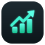

<p align="center">
  
</p>

# AlphaDesk: App User Guide

AlphaDesk is a stock-trading desk that runs on your own computer. Every trading day it scores the
S&P 500 (and any stocks you add) with its own models, suggests what to buy and sell within a budget you set,
and can ask a team of AI agents (analysts, a bull/bear debate, a trader, risk analysts and a portfolio
manager) for a second opinion on any stock. It keeps an honest track record of every pick it made.

> **AlphaDesk never places an order.** You place trades yourself in your broker's app, then record them in
> AlphaDesk. Everything it shows is a model estimate from past data, not a promise and not financial advice.

---

## 1. Install

You need **Python 3.11 or newer** ([python.org](https://www.python.org/downloads/)).

**From the installer file** (`tradingagents-<version>-py3-none-any.whl`):

```bash
pip install tradingagents-0.7.0-py3-none-any.whl
# with the forecasting models (XGBoost, LightGBM, DuckDB, GARCH, Mamba):
pip install "tradingagents-0.7.0-py3-none-any.whl[research]"
```

**From this repository:**

```bash
git clone <this repository's URL>
cd <the cloned folder>
pip install -e ".[research]"
```

To build the installer file yourself: `uv build --wheel --out-dir dist` (or `python -m build --wheel`).

## 2. Start and stop

Make a folder for your records, open a terminal in it, and run:

```bash
tradingagents web
```

AlphaDesk opens in your browser at **http://127.0.0.1:8765/**. Press **Ctrl+C** in the terminal to stop it.

- `--port 8800` runs it on another port. Only one copy can use a port at a time.
- Run it from the same folder each time: that folder holds your records (see section 6).
- If the `tradingagents` command is not found, use `python -m cli.main web` instead.

## 3. First-time setup (Settings tab)

1. **API keys.** Paste the keys you have. They are saved in a `.env` file in your records folder, used at
   once without a restart, and only ever shown masked. None is required to browse prices and models; the AI
   features need at least one model provider.

   | Key | Used for |
   |---|---|
   | `OPENAI_API_KEY`, `ANTHROPIC_API_KEY`, `GOOGLE_API_KEY`, `OPENROUTER_API_KEY`, `XAI_API_KEY`, `DEEPSEEK_API_KEY`, … | The AI agents (any one provider is enough) |
   | `OPENROUTER_API_KEY_2` | A second OpenRouter key, tried when the first hits a limit |
   | `GEMINI_CONTEXT_API_KEY` | Non-agent AI work: the Trend page brief, ticker news, the moat check |
   | `FRED_API_KEY` | Economic data (free at [fred.stlouisfed.org](https://fred.stlouisfed.org/docs/api/api_key.html)) |
   | `ALPHA_VANTAGE_API_KEY` | Optional backup market data |

2. **Agent models.** Choose a default provider, a *quick* model (analysts, debaters, trader) and a *deep*
   model (research and portfolio managers). Putting the two sides of each debate on different providers stops
   one model arguing with itself. **Every model needs a price** (dollars per million tokens); a model with no
   price is refused before any call, so its cost can be held to your budget. *Use free Gemini* sets up a
   no-cost configuration.
3. **Money.** Set the **trading budget**: the money set aside for buying stocks. Buys are sized from what is
   left of it. Saving a new amount starts the count again from today. It moves no money.
4. **Companies the model scores.** The whole S&P 500 is scored after each close; add any other US-listed
   stocks here.
5. **Every morning.** With the app running, after the time you choose it records the fund forecasts, scores
   every stock with every model and makes the daily decision, once per new close. Models are refitted every
   *N* trading sessions (you choose *N*).

## 4. A normal day

1. **Open AlphaDesk** after the market closes or before the next open. The models work from the last
   completed close.
2. **Trade tab → Make today's decision** (it fits the models first if they need it). Read:
   - **Model's picks**: the best buy and the runners-up, each with an *Amount* (your budget split across the
     picks), the *LTP* (live from Yahoo while the market is open, shown with a green dot; otherwise the last
     close), a *Buy at* limit price, and a *Sell* target and *Stop* loss.
   - **Sell**: what you hold, the suggested action, profit so far, sell target, stop and deadline.
3. **Optionally ask the AI.** *Ask the AI to pick* has the AI rank the market and the full agent team analyse
   its top stocks; *Replace the AVOIDs* screens again for stocks the team rejected. The **AI** button on any
   row runs the agents on that one stock. You can watch them work live on *The Trading Floor*.
4. **Place the orders yourself** in your broker's app.
5. **Record what happened** on the **Portfolio** tab (*Record a trade*: side, ticker, units, price, date).
   Holdings change only through what you record, never because a plan was shown or saved.

## 5. The tabs

| Tab | What it shows |
|---|---|
| **Trade** | Today's decision: the model's picks, what to sell, the AI's pick, the live agent floor, the model's live record, and the *trade outcome model* (buy at the next close, buy on a limit, or hold cash; it abstains until its validation passes). |
| **Trend** | Market context: economic conditions, *Why it's happening* (one AI call explains the day's moves from headlines and data, citing sources), sector rotation (Improving → Leading → Weakening → Lagging), sectors and disruptive themes over the last month, S&P 500 breadth, and returns. Context only: it is not part of the decision. |
| **Screener** | Every S&P 500 stock (and your watchlist) on a quality checklist (moat, financial strength, profitability, 0–100), Wall Street consensus and price-target upside, combined into one rank. Also the stock models' signals (breakout, breakdown, crash and deep-drawdown warnings, trend) and every model's ranking. Click a column to sort, a ticker for its page. |
| **Forecasts** | Return forecasts for the major ETFs or S&P 500 stocks over 5, 20 or 60 sessions from local models (Elastic Net, Momentum, XGBoost variants, Chronos-2, optionally TimesFM 3.0). Each comes with a 5–95% range, its live record, and a walk-forward comparison (IC, R², calibration, coverage). No paid AI. |
| **Decisions** | Two decisions side by side. *AI decisions*: the agent team's BUY / HOLD / SELL for chosen stocks, next to the app's own model verdict, with a daily and monthly AI budget. *Quant model decision*: the fitted models' ENTER / WAIT / HOLD / EXIT sized to your budget, with positions, candidates, a shadow account and the action history. |
| **Portfolio** | Your recorded holdings at the latest close (units, cost first-in-first-out, value, profit), the trade log, and **tracked tickers**: stocks you follow without holding, scored every morning too. |
| **Track record** | Every pick the model made and every rating the agents gave, followed for 20 trading days from when it could first be bought, and judged only once those 20 days are over. Shown as the value of $1 put into each group. |
| **Settings** | Money, scored companies, the morning schedule, API keys, agent models and prices, and the ETFs to forecast. |

**The ticker page** (click any ticker): price chart (1 day, 5 days and longer), the quality checklist,
valuation, analysts, news, the models' views, the agents' entry plans (Buy at, Sell, Stop, valid until) and
their full reports. Running the agents from a stock's own page always makes a fresh run; elsewhere a stock
whose plan is still valid is not run again.

### How to read the prices

- **Buy at**: one limit price, from the low end of the agents' entry range, else their entry price, else the
  internal model's (marked **m**).
- **Sell / Stop**: the agents' target and stop-loss. A level on the wrong side for a buy (for example a
  stop above the entry) is not used, and the internal model's is shown instead (marked **m**).
- **LTP**: the live price is for display only. No model or saved decision reads it. A stop can gap, so a
  sale at the next close can lose more than the stop.

## 6. Your records and data

Everything lives in the folder you start AlphaDesk from:

| File | What it is |
|---|---|
| `portfolio.sqlite3` | All your records: trades, holdings, settings, decisions, AI usage and cost. One self-contained file; copy it to back it up or to move to another computer. |
| `.env` | Your API keys. **Never share or commit this file.** |
| `my_portfolio.json`, `my_buys.json`, `my_universe.json` | Kept in step with the database for older tools. Do not edit them by hand. |
| `backups/` | A copy of the database taken automatically before every upgrade of its format. |

Prices, news and fundamentals come from Yahoo Finance and SEC EDGAR (free), economic data from FRED, and
prediction-market odds from Polymarket. Downloads are cached on disk.

## 7. AI costs

- No paid AI call runs unless you start one (the AI buttons, *Ask the AI to pick*, *Explain today's moves*,
  *Refresh the brief*), or the morning schedule does work that needs it.
- Every request is checked against the **AI budget** (a day and a month, on the Decisions tab) *before* it is
  sent. A run that would exceed it stops instead of trying each stock.
- Every request's tokens and cost are recorded. A model without a price cannot be called.
- A typical full agent run on one stock is about 150,000 input and 40,000 output tokens. On a small, cheap
  model that is a few cents; on a large frontier model it can be close to a dollar.
- Results are saved, so opening a page again does not pay again.

## 8. Command line

| Command | What it does |
|---|---|
| `tradingagents web` | Starts AlphaDesk (options: `--port`, `--portfolio`, `--schedule`) |
| `tradingagents` | The interactive agent run on one ticker in the terminal (`--ticker NVDA --date 2026-10-29`) |
| `tradingagents backtest NVDA,AAPL --start 2025-01-02 --end 2025-06-30` | Runs the agents over past dates and scores them |
| `tradingagents trade` | The trading plan in the terminal |
| `tradingagents --help` | Every command and option |

More detail: [docs/HOW_IT_WORKS.md](docs/HOW_IT_WORKS.md) (how the agent team works inside),
[docs/RUNNING.md](docs/RUNNING.md) (records and bookkeeping commands),
[docs/FORECASTING.md](docs/FORECASTING.md) and [docs/DECISIONS.md](docs/DECISIONS.md) (the models).

## 9. Limits

- The models learn from past prices. A future crash can be deeper than any past one. The daily model showed
  a small ranking edge in testing, but trading on it did not beat holding SPY.
- The agents' reports are AI-written and can be wrong, even when they cite sources.
- Social-media sentiment is only available for recent days, so past runs do not see the sentiment of their date.
- Nothing here is financial advice.

## 10. Troubleshooting

| Problem | Fix |
|---|---|
| *Port already in use* | A copy is already running: open http://127.0.0.1:8765/, or start with `--port 8800`. |
| *No price is configured for …* | Settings → Agent models → set the model's input and output price. |
| *Over budget* | Raise the AI budget on the Decisions tab, or wait for the next day or month. |
| Empty portfolio on a new computer | Copy `portfolio.sqlite3` (and `.env`, privately) into the folder you start from. |
| `tradingagents` not found | Use `python -m cli.main web`, or add Python's Scripts folder to your PATH. |

---

<sub>AlphaDesk is built on [TradingAgents](https://github.com/TauricResearch/TradingAgents) by Tauric Research
(Xiao, Sun, Luo and Wang, *TradingAgents: Multi-Agents LLM Financial Trading Framework*,
[arXiv:2412.20138](https://arxiv.org/abs/2412.20138)), used under the Apache License 2.0; see [LICENSE](LICENSE).</sub>
