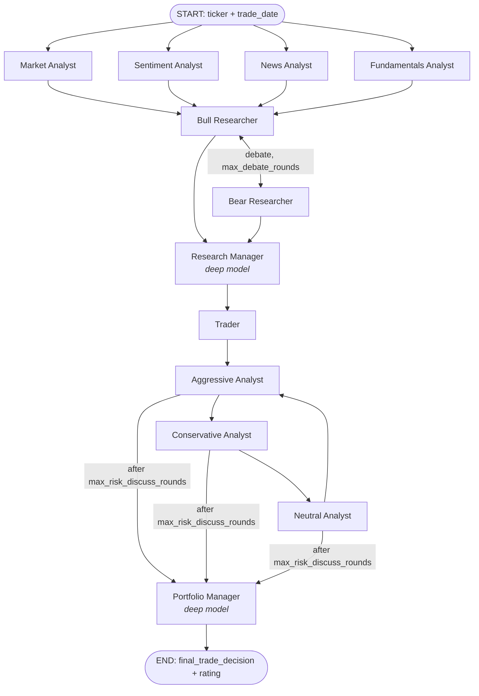

# How TradingAgents Works

TradingAgents (v0.5.2, by Tauric Research) is a multi-agent LLM framework that imitates the way a trading firm makes a call. For one ticker on one date, a team of LLM "employees" (analysts, researchers, a trader, risk analysts and a portfolio manager) gathers data, debates it, and ends with a **5-tier rating**: `Buy`, `Overweight`, `Hold`, `Underweight` or `Sell`. If the final text has no readable rating, the result is `REVIEW` instead.

The project is a research tool. **It does not place orders or connect to a broker.** The output is reports plus a rating.

This page explains the internals. For installation and CLI flags, see the [README](../README.md).

---

## 1. The big picture



The pipeline is a [LangGraph](https://langchain-ai.github.io/langgraph/) `StateGraph`, wired in [tradingagents/graph/setup.py](../tradingagents/graph/setup.py). Every node reads from and writes to one shared state dict, `AgentState` ([agents/state.py](../tradingagents/agents/state.py)).

| Stage | Agents | Model | Output written to state |
|---|---|---|---|
| 1. Analysis (runs in parallel) | Market, Sentiment, News, Fundamentals | quick | `market_report`, `sentiment_report`, `news_report`, `fundamentals_report` |
| 2. Investment debate | Bull ↔ Bear Researchers | quick | `investment_debate_state` |
| 3. Plan | Research Manager | **deep** | `investment_plan` (structured `ResearchPlan`) |
| 4. Proposal | Trader | quick | `trader_investment_plan` (structured `TraderProposal`) |
| 5. Risk debate | Aggressive → Conservative → Neutral (round-robin) | quick | `risk_debate_state` |
| 6. Decision | Portfolio Manager | **deep** | `final_trade_decision`, `final_rating` (structured `PortfolioDecision`) |

Two LLMs are configured:

- **`quick_think_llm`** does the high-volume work: analysts, debaters and the trader.
- **`deep_think_llm`** handles the two judgment calls: the Research Manager and the Portfolio Manager.

---

## 2. Entry points

| Entry point | File | What it does |
|---|---|---|
| `tradingagents` CLI | [cli/main.py](../cli/main.py) | Interactive Typer/Rich UI that asks for ticker, date, analysts and provider, then streams progress live. `--ticker`/`--date` skip the prompts. |
| `tradingagents backtest` | [cli/main.py](../cli/main.py) → [tradingagents/backtest.py](../tradingagents/backtest.py) | Runs the graph over a grid of tickers × dates and scores the results. |
| Python API | [main.py](../main.py) | `TradingAgentsGraph(config=...).propagate("NVDA", "2026-09-01")` returns `(final_state, rating)`. |

All three go through **`TradingAgentsGraph`** in [graph/trading_graph.py](../tradingagents/graph/trading_graph.py).

### What `propagate()` does, step by step

1. **Validates the date.** It must be `YYYY-MM-DD` and cannot be in the future.
2. **Settles past decisions** (`settle_pending`). Earlier pending decisions for this ticker whose holding window has passed are scored, and a reflection is written for each (see §5).
3. **Builds the initial state** (`create_run_state`). This injects:
   - `instrument_context`: the real company identity, looked up once from yfinance so that agents do not invent a company from the ticker.
   - `past_context`: lessons from the memory log. For historical runs, only lessons already known by the trade date are included.
   - `portfolio_context`: your current holdings and cash, if you passed a portfolio file.
4. **Runs the graph.** It uses `invoke`, or `stream` in debug mode or the CLI. If checkpointing is on, it goes through a SQLite checkpointer.
5. **Records the decision** (`record_decision`). The full state goes to JSON, and the decision goes into the memory log as `pending`.
6. **Returns** `(final_state, rating)`.

---

## 3. The agents

### Analysts ([agents/analysts/](../tradingagents/agents/analysts/))

Each tool-using analyst runs as its own **subgraph** (`_analyst_graph` in [setup.py](../tradingagents/graph/setup.py)) with a private message history. The loop works like this:

```
agent → (tool calls?) → tools → agent → ... → report
```

After `max_tool_rounds` rounds (default 20), the analyst receives a `WRAP_UP` message and must write its report without tools ([turn.py](../tradingagents/agents/analysts/turn.py)). Only the finished report goes back to the parent graph, so analysts running in parallel never interfere with each other.

| Analyst | Config key | Tools / data |
|---|---|---|
| Market | `market` | `get_stock_data` (OHLCV), `get_indicators` (SMA, EMA, MACD, RSI, Bollinger, ATR, VWMA via `stockstats`), `get_verified_market_snapshot`, which is the source of truth for exact numbers |
| Sentiment | `social` | **No tools.** It fetches Yahoo news, StockTwits and Reddit (r/wallstreetbets, r/stocks, r/investing) itself and puts them in the prompt. Output is a structured `SentimentReport`. |
| News | `news` | `get_news`, `get_global_news`, `get_macro_indicators` (FRED), `get_prediction_markets` (Polymarket) |
| Fundamentals | `fundamentals` | `get_fundamentals`, balance sheet, cash flow, income statement (SEC EDGAR as filed, then Yahoo), insider transactions |

You can run any subset of analysts. At least one is required.

### Researchers and managers

- **Bull / Bear Researchers** ([researchers/](../tradingagents/agents/researchers/)) take turns rebutting each other using all analyst reports. [conditional_logic.py](../tradingagents/graph/conditional_logic.py) ends the debate after `2 × max_debate_rounds` turns.
- **Research Manager** ([managers/research_manager.py](../tradingagents/agents/managers/research_manager.py)) judges the debate and produces a structured `ResearchPlan`.
- **Trader** ([trader/trader.py](../tradingagents/agents/trader/trader.py)) turns the plan into a `TraderProposal`.
- **Risk debaters** ([risk_mgmt/](../tradingagents/agents/risk_mgmt/)) argue from aggressive, conservative and neutral positions, rotating for `3 × max_risk_discuss_rounds` turns.
- **Portfolio Manager** ([managers/portfolio_manager.py](../tradingagents/agents/managers/portfolio_manager.py)) reads the plan, the proposal, the risk debate, past lessons and your portfolio, and outputs the final `PortfolioDecision` (Rating, Executive Summary, Investment Thesis).

### Structured output, with a fallback

The managers, the trader and the sentiment analyst ask the model for a Pydantic schema ([schemas.py](../tradingagents/agents/schemas.py), [structured.py](../tradingagents/agents/structured.py)). If a provider does not support structured output, they fall back to free text. For the Portfolio Manager, the rating is then parsed from that text by [rating.py](../tradingagents/agents/rating.py). An unreadable rating becomes `REVIEW`, never a silent `Hold`.

---

## 4. Data layer ([tradingagents/dataflows/](../tradingagents/dataflows/))

```
LLM tool call  →  agents/tools.py  →  dataflows/router.py (route_to_vendor)  →  vendors/<vendor>.py
```

- **Tools** ([agents/tools.py](../tradingagents/agents/tools.py)) are LangChain `@tool`s. The ticker and `trade_date` come from graph state (`InjectedState`), so the model cannot request a different symbol.
- **No look-ahead.** [date_window.py](../tradingagents/dataflows/date_window.py) limits every requested date or window to the run's `trade_date`. This keeps backtests honest: a run dated in 2025 never sees data from after its date. One exception: the social feeds (StockTwits, Reddit) only serve recent posts, so historical sentiment is not point-in-time.
- **Vendor routing.** [router.py](../tradingagents/dataflows/router.py) maps each tool to the vendors set in `config["data_vendors"]` (per category) or `config["tool_vendors"]` (per tool). The configured list *is* the fallback chain, so `"yfinance,alpha_vantage"` tries Yahoo first and then Alpha Vantage. No vendor you didn't list is ever used.
- **Optional categories.** `macro_data` and `prediction_markets` degrade to a placeholder message on failure. Core categories (prices, fundamentals, news) raise an error instead.

| Category | Default vendor | Alternatives | Key needed |
|---|---|---|---|
| `core_stock_apis` | yfinance | alpha_vantage | no |
| `technical_indicators` | yfinance | alpha_vantage | no |
| `fundamental_data` | sec_edgar, yfinance | alpha_vantage | `SEC_EDGAR_USER_AGENT` (contact string) |
| `news_data` | yfinance | alpha_vantage | no |
| `macro_data` | fred | n/a | `FRED_API_KEY` |
| `prediction_markets` | polymarket | n/a | no |

Price data is cached as CSV under `data_cache_dir`.

---

## 5. Memory and learning ([tradingagents/memory/](../tradingagents/memory/))

The system "learns" through a plain markdown log. It does not fine-tune anything.

1. At the end of each run, [log.py](../tradingagents/memory/log.py) appends an entry tagged `[date | ticker | rating | pending]` to `~/.tradingagents/memory/trading_memory.md`.
2. On the **next run for the same ticker**, [settlement.py](../tradingagents/memory/settlement.py) checks whether `holding_period_days` (default 5) trading days have passed. If they have, it computes:
   - the raw return, and
   - the **alpha** against a benchmark: SPY for US tickers, or the regional index chosen by exchange suffix (`.T` → Nikkei, `.L` → FTSE, and so on).
3. [reflection.py](../tradingagents/memory/reflection.py) asks the quick LLM for a 2–4 sentence lesson, which is stored with the entry.
4. Future runs inject these lessons into `past_context`, which the Portfolio Manager reads.

The most recent decision for a ticker therefore stays `pending` until you analyse that ticker again, or until you call `settle_pending()` yourself.

---

## 6. LLM providers ([tradingagents/llm_clients/](../tradingagents/llm_clients/))

[factory.py](../tradingagents/llm_clients/factory.py) `create_llm_client()` builds a LangChain chat model for:

- **Dedicated clients:** `anthropic`, `google`, `azure` and `bedrock` (Bedrock needs `pip install ".[bedrock]"`).
- **OpenAI-compatible:** `openai`, plus xAI, DeepSeek, DashScope, Zhipu, MiniMax, OpenRouter, Mistral, Moonshot, Groq, NVIDIA, Ollama and any custom endpoint (vLLM, LM Studio, llama.cpp) set through `backend_url`.

`build_llm_kwargs()` passes on the cross-provider settings `temperature`, `llm_max_retries` and `max_tokens`. It also passes the provider-specific reasoning settings: `openai_reasoning_effort`, `google_thinking_level` and `anthropic_effort`.

---

## 7. Configuration

All defaults are in [default_config.py](../tradingagents/default_config.py). Settings are applied in this order:

```
DEFAULT_CONFIG  ←  TRADINGAGENTS_* env vars (.env)  ←  dict you pass in code / CLI choices
```

Most useful keys:

| Key | Default | Env var | Meaning |
|---|---|---|---|
| `llm_provider` | `openai` | `TRADINGAGENTS_LLM_PROVIDER` | Which provider to use |
| `deep_think_llm` / `quick_think_llm` | `gpt-6-sol` / `gpt-6-luna` | `TRADINGAGENTS_DEEP_THINK_LLM` / `_QUICK_THINK_LLM` | Models for the deep and quick roles |
| `max_debate_rounds` | 1 | `TRADINGAGENTS_MAX_DEBATE_ROUNDS` | Bull/Bear rounds |
| `max_risk_discuss_rounds` | 1 | `TRADINGAGENTS_MAX_RISK_ROUNDS` | Risk-debate rounds |
| `max_tool_rounds` | 20 | `TRADINGAGENTS_MAX_TOOL_ROUNDS` | Tool-call rounds per analyst before wrap-up |
| `output_language` | English | `TRADINGAGENTS_OUTPUT_LANGUAGE` | Language of reports (internal debate stays in English) |
| `checkpoint_enabled` | False | `TRADINGAGENTS_CHECKPOINT_ENABLED` | Resume crashed runs from SQLite |
| `holding_period_days` | 5 | n/a | Window used to score decisions |
| `results_dir`, `data_cache_dir`, `memory_log_path` | under `~/.tradingagents/` | `TRADINGAGENTS_RESULTS_DIR`, `_CACHE_DIR`, `_MEMORY_LOG_PATH` | Where files go |

API keys go in `.env`. See [.env.example](../.env.example) for the full list.

---

## 8. Outputs and persistence

| What | Where (defaults) |
|---|---|
| Full final state (JSON) | `<results_dir>/<TICKER>/TradingAgentsStrategy_logs/full_states_log_<date>.json` |
| Markdown report tree | `<results_dir>/reports/<TICKER>_<timestamp>/`, written by `save_reports()` or the CLI ([reporting.py](../tradingagents/reporting.py)) |
| Memory log | `~/.tradingagents/memory/trading_memory.md` |
| Checkpoints | `<data_cache_dir>/checkpoints/<TICKER>.db`, keyed by ticker + date + a hash of the config, so a resume with different settings starts fresh |
| Price cache | `<data_cache_dir>/` |

### Optional portfolio input

Pass a JSON file such as `{"cash": 10000, "currency": "USD", "positions": [{"ticker": "NVDA", "quantity": 10, "average_price": 120}]}` with `--portfolio`, or `portfolio=` in Python ([portfolio.py](../tradingagents/portfolio.py)). The decision agents can then tell "add to a position" apart from "open a new one".

---

## 9. Backtesting

[backtest.py](../tradingagents/backtest.py) runs `propagate()` for every (ticker, date) pair on a grid. The grid never goes past today. Results are read back from the memory log, where each decision is settled against its benchmark. This measures **decision quality only**. It deliberately does not simulate fills, position sizes or a cash ledger.

```bash
tradingagents backtest --start 2026-01-05 --end 2026-06-30 --every 7 NVDA,AAPL
```

Each cell is a full multi-agent run, so LLM costs grow quickly.

---

## 9b. Daily portfolio optimizer (local addition)

This layer is not part of the upstream project. It sits on top of the agents and answers a portfolio question instead of a single-ticker one.

| Piece | File | Role |
|---|---|---|
| Risk figures | [optimizer/data.py](../tradingagents/optimizer/data.py) | Full-history prices. Volatility, Sharpe and covariance over 10 years. A **stress loss** per fund: its worst peak-to-trough drop, taken from a long-lived stand-in (QQQM→QQQ, AVUV→VBR) or floored at 50% for young funds. |
| Solver | [optimizer/solve.py](../tradingagents/optimizer/solve.py) | Maximizes growth − risk penalty, subject to `Σ weight × stress loss ≤ limit`, with per-fund caps. Augmented Lagrangian with accelerated (FISTA) projected-gradient steps, so scipy isn't needed. |
| Plan and orders | [optimizer/plan.py](../tradingagents/optimizer/plan.py) | Target mix, trades, new daily buy split, and the loss-limit frontier. `daily_orders()` applies T+1: buys use only settled cash, and SGOV is sold today to fund tomorrow's buys. |
| AI tilt | [optimizer/ai_views.py](../tradingagents/optimizer/ai_views.py) | Runs the agents (market and news analysts) on each holding. Buy/Sell ratings nudge expected returns, but never the loss limit. Ratings are reused for the rest of the day through the memory log. |
| Fund scan | [optimizer/universe.py](../tradingagents/optimizer/universe.py) | About 40 liquid ETFs (stocks, sectors, international, bonds, gold, commodities, leveraged) scanned alongside your holdings. Long-lived funds are preferred and near-duplicates left out. Editable in the app (`my_universe.json`). Prices are downloaded once a day in one batch and cached. |
| Reasons | `_explain` in [optimizer/plan.py](../tradingagents/optimizer/plan.py) | One sentence per fund naming the number that set its weight: growth above cash, worst drop, which cap bound, or which chosen fund it duplicates. |
| Wider scan | [optimizer/universe.py](../tradingagents/optimizer/universe.py), [vendors/index_members.py](../tradingagents/dataflows/vendors/index_members.py) | Three switchable groups: ETFs, the S&P 500 (member list cached weekly), and disruptive themes plus small-cap funds. About 570 tickers are scored cheaply (no covariance), and the best 60 plus your holdings go to the optimizer. The rest get a "screened out, ranked N" reason. Young stocks' past returns are trusted in proportion to their years of history. |
| Market (Today page) | [optimizer/market.py](../tradingagents/optimizer/market.py) | Returns for indexes, sectors, rates, gold, bitcoin and VIX over 1D–1Y; S&P 500 breadth, leaders and laggards; median 1-month move per disruptive theme. An optional, once-a-day AI explanation reads the week's numbered Yahoo headlines and FRED data, and must cite headline numbers. A trend with no citation is shown as low confidence. Falls back to Gemini when the main provider fails. |
| Paper tracker | [optimizer/tracker.py](../tradingagents/optimizer/tracker.py) | The long-term record (Performance tab). Starts automatically on the first visit and is never restarted by a risk change: each day stores both values, the risk cap in force and the share invested. "Start over" archives the old ledger instead of deleting it. From a start day, two paper portfolios ("followed the plan" vs "kept as is") are updated each trading day after the close, under T+1. The ledger is `paper_tracker.json`. Trades smaller than 0.5% of the portfolio are skipped, so it does not churn. |
| Backtest | [optimizer/backtest.py](../tradingagents/optimizer/backtest.py) | Walk-forward: monthly rebalances using only prices known at the time, against VTI, 60/40 and your current mix. AI ratings and fund closures are not covered. |
| Risk levels | [optimizer/risk.py](../tradingagents/optimizer/risk.py) | A 1-10 dial in place of a raw loss limit: 1% stress loss at level 1 up to 50% at level 9, and no stress limit at level 10. Saved in `my_risk.json` and shared by the web app and the CLI. |
| Web app | [webapp/](../tradingagents/webapp/) | Local-only page (127.0.0.1) with a risk-level slider, today's orders, a frontier chart, and holdings and buy editors. Each visit saves that day's suggestion to `<results_dir>/optimizer/<date>.md`. |

```bash
python -m cli.main web                      # open the web app
python -m cli.main suggest                  # today's orders at the saved risk level (--no-scan: holdings only)
python -m cli.main suggest --risk 5         # at risk level 5, saved for next time
python -m cli.main suggest --ai             # with agent ratings (uses LLM credit)
python -m cli.main track                    # record the paper portfolios for each closed day (run daily)
```

Holdings and settled cash live in `my_portfolio.json`; recurring buys in `my_buys.json`. A ChatGPT version of the same method is in [CHATGPT_PROMPT.md](CHATGPT_PROMPT.md).

---

## 10. Repository map

```
TradingAgents/
├── main.py                     # minimal Python example
├── cli/                        # Typer + Rich interactive CLI
├── tradingagents/
│   ├── default_config.py       # all settings + env-var overrides
│   ├── graph/                  # LangGraph wiring, routing, checkpoints, TradingAgentsGraph
│   ├── agents/                 # analysts, researchers, managers, trader, risk debaters,
│   │                           # tools.py, schemas.py, rating.py, state.py
│   ├── dataflows/              # router, point-in-time rules, vendors (yahoo, alpha_vantage,
│   │                           # sec_edgar, fred, polymarket, reddit, stocktwits)
│   ├── llm_clients/            # provider factory and per-provider clients
│   ├── memory/                 # decision log, settlement (alpha), reflection
│   ├── backtest.py, portfolio.py, reporting.py
└── tests/                      # pytest suite (integration tests excluded by default)
```

---

## 11. Running it

```bash
cd TradingAgents
python -m venv .venv && .venv\Scripts\activate      # Windows
pip install -e ".[dev]"
copy .env.example .env                                # then add your API key(s)

tradingagents                                         # interactive CLI
tradingagents --ticker NVDA --date 2026-10-01         # skip the prompts
python main.py                                        # Python API example
pytest                                                # unit tests
```

**Cost note:** with all four analysts and one round of each debate, a run makes roughly a dozen top-level LLM calls, plus up to 20 tool rounds per tool-using analyst. Fewer analysts or cheaper quick models reduce cost the most.
